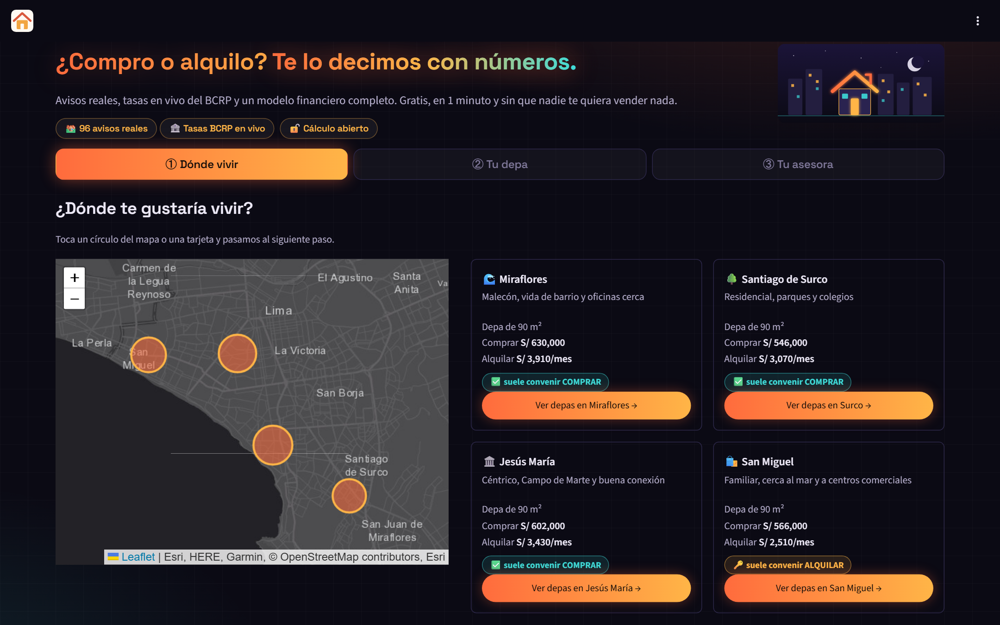
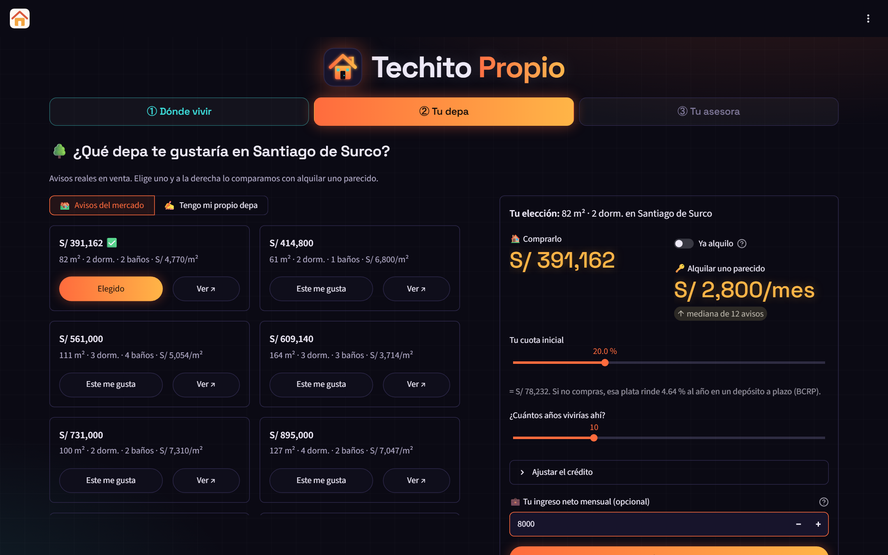
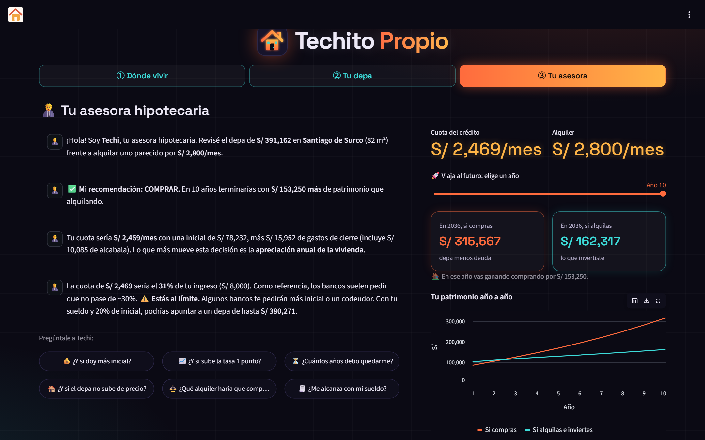
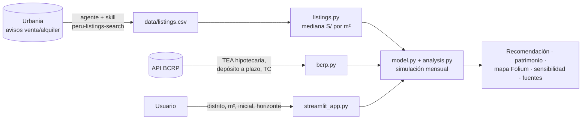

# 🏠 Techito Propio

> **Ayudamos a quienes alquilan en Lima a decidir si les conviene comprar o seguir alquilando, con precios reales del mercado, tasas en vivo del BCRP y un modelo financiero completo.**

**Demo:** https://techito-propio.streamlit.app · **Video de respaldo:** _[pendiente: link al video de 60–90 s]_

---

## 1. One-liner

Hacemos la cuenta de "¿compro o alquilo?" para inquilinos de Lima, usando avisos reales de Urbania, tasas del BCRP y un modelo de patrimonio a N años.

## 2. Founder

| | |
|---|---|
|  | **Karelyss Collazos**: estudiante de la Universidad del Pacífico (Data Science con Python, 2026-II). Quiero que la decisión financiera más grande de una persona se tome con números y no "a ojo". |

Soy la única founder. Cubro cada frente con agentes de IA:
- **Producto:** definí el flujo (distrito → tamaño → inicial → horizonte → recomendación) a partir de 3 perfiles de usuario.
- **Ingeniería:** Claude Code escribió la mayor parte del código bajo mi dirección. Yo revisé y validé el modelo financiero.
- **Datos:** un agente con skills propias (`.claude/skills/`) busca avisos y los normaliza en un CSV con su fuente.
- **Diseño y ventas:** la interfaz es Streamlit. El canal de ventas es B2B (sección 7).

## 3. Problema

**Quién lo sufre:** profesionales de 25 a 45 años que alquilan un departamento en distritos de Lima Moderna y Lima Centro (Miraflores, Surco, San Borja, Jesús María, San Miguel, Magdalena, Pueblo Libre, Lince y La Victoria), con ahorros para una cuota inicial y una oferta de crédito hipotecario en la mano.

**Cuánto les cuesta:** es la decisión financiera más grande de su vida. En un depa de 90 m² en Surco (~S/ 546,000), equivocarse puede significar **más de S/ 70,000 de patrimonio** en 10 años (ver la demo). Además:
- Pagan costos que no sabían que existían: alcabala (3 % sobre el exceso de 10 UIT), gastos de cierre, seguros, predial y mantenimiento.
- No cuentan el **costo de oportunidad** de la cuota inicial, que en un depósito a plazo rinde ~4.6 % al año (BCRP).

**Cómo lo resuelven hoy:**
1. **"A ojo" o con la frase "alquilar es botar la plata".**
2. **El simulador del banco**, que solo calcula la cuota y tiene incentivo para que compres.
3. **Un Excel propio** que compara cuota vs. alquiler y omite apreciación, costos de cierre y costo de oportunidad.
4. **El vendedor de la inmobiliaria**, con conflicto de interés.

**Evidencia:** [docs/research/](docs/research/) tiene 3 perfiles de usuario. ⚠️ **Son perfiles hipotéticos, no conversaciones reales.** Los construí por falta de tiempo en el sprint y están marcados así en cada archivo. El siguiente paso es validarlos con usuarios reales.

## 4. Solución e insight

**Qué construí:** una web app con un recorrido guiado de 3 pasos:
1. **¿Dónde quieres vivir?** Eliges el distrito en un mapa con precios reales.
2. **Elige tu depa.** Escoges un aviso real en venta y lo comparas con el alquiler de uno parecido.
3. **Tu asesora hipotecaria.** "Techi" te da el veredicto en un chat y responde preguntas como "¿y si sube la tasa?" o "¿cuántos años debo quedarme?", recalculando el modelo en vivo.

En el camino ves:
- **La recomendación** (comprar o alquilar) y la diferencia de patrimonio al final del horizonte.
- **El alquiler de equilibrio:** cuánto tendría que costar el alquiler para que comprar convenga.
- **Un mapa** que compara tu mismo caso en 9 distritos, ordenados del más accesible al más caro.
- **Qué supuesto pesa más** (análisis de sensibilidad).
- **Los avisos reales** usados como fuente, con enlace a cada uno.

**Insight:** la pregunta correcta no es "¿la cuota es parecida al alquiler?", sino **"¿con cuánto patrimonio termino en N años en cada camino?"**. En Lima la respuesta **cambia por distrito**. Con los datos de hoy, un depa de 90 m² en **Surco conviene comprarlo** y uno similar en **San Miguel conviene alquilarlo**, porque allá el alquiler es barato frente al precio de venta (PER más alto). Ningún simulador de banco ni portal inmobiliario te muestra eso, porque su negocio es que compres.

**Cómo evolucionó la idea:**

| Versión inicial (4/11, ejercicio de clase) | Techito Propio (hoy) |
|---|---|
| Agente en la terminal, solo para quien sabe usar Claude Code | Web app pública en un recorrido de 3 pasos |
| Formulario con 12 sliders técnicos | Eliges distrito en un mapa y un **depa real** de una lista |
| Tasas escritas a mano en un JSON | **Tasas en vivo del API del BCRP** |
| Un resultado estático | **Asesora "Techi"** que conversa y recalcula ante cada pregunta |
| No sabías si el banco te prestaría | **"¿Me alcanza?"**: cuota frente a tu sueldo y precio máximo que puedes pagar |
| Sin entregable | **Informe descargable** con checklist para ir al banco (el producto Premium) |
| Solo el perfil de ejemplo | **"Tengo mi propio depa"**: pones precio (S/ o US$), m² y si es de estreno, y te dice si está caro frente al distrito |
| Un número final | **"Viaja al futuro"**: eliges un año y ves tu patrimonio en cada camino |
| 4 distritos caros | **9 distritos**, incluidos los medianamente accesibles (Pueblo Libre, Lince, La Victoria, Magdalena), **ordenados del más accesible al más caro** |

## 5. Why now

- **Datos abiertos y en vivo:** el API del BCRP publica la TEA hipotecaria promedio (7.47 % en oct-2026) y las tasas de depósitos sin costo ni registro.
- **Agentes de código:** hace tres años, juntar scraping, un modelo financiero, un API y un mapa requería un equipo. Hoy una persona con Claude Code lo construye en días, y un agente puede mantener los datos actualizados.
- **Tasas a la baja:** la tasa hipotecaria promedio bajó de 8.13 % a 7.83 % en los 12 meses a febrero de 2026 ([BCRP, nota informativa 16/03/2026](https://www.bcrp.gob.pe/docs/Transparencia/Notas-Informativas/2026/nota-informativa-2026-03-16.pdf)). Más personas se están haciendo la pregunta ahora.

## 6. Demo

- **URL pública:** https://techito-propio.streamlit.app
- **En local:**
  ```bash
  pip install -r requirements.txt
  streamlit run streamlit_app.py
  ```
- **Capturas del flujo principal** (app pública, 15/11/2026):

| ① ¿Dónde quieres vivir? | ② Elige tu depa | ③ Tu asesora Techi |
|---|---|---|
|  |  |  |
| Mapa nocturno con 9 distritos y un adelanto del veredicto | Avisos reales de Urbania (o tu propio depa) frente al alquiler de uno parecido | Recomendación, "¿Me alcanza?" con tu sueldo, "Viaja al futuro" e informe descargable |
- **Arquitectura:** [docs/arquitectura.md](docs/arquitectura.md)



**Modelos y APIs, y por qué:**
- **API del BCRP** (series `PN07848NM`, `PN07815NM`, `PD04640PD`): es la fuente oficial, gratuita y sin clave, y se actualiza sola. Si no responde, la app usa valores por defecto y lo indica.
- **Modelo financiero propio en Python** (`model.py`): cuota francesa con TEA, alcabala, seguros, predial, mantenimiento, comisión de venta y costo de oportunidad, mes a mes. No uso un LLM para el cálculo porque el resultado debe ser **exacto y auditable**.
- **Folium:** el mapa de distritos, en Python y gratis.
- **Sin LLM en producción:** el costo por usuario es casi cero. Los agentes de IA trabajan en el *backoffice*: recolectan y normalizan los datos.

## 7. Modelo de negocio

| Plan | Quién paga | Precio | Qué recibe |
|---|---|---|---|
| **Gratis** | Nadie (el usuario) | S/ 0 | Recomendación, mapa y avisos |
| **Informe Premium** | El usuario | **S/ 19** pago único | PDF con su caso, escenarios y checklist para el banco |
| **Lead calificado** | Bancos e inmobiliarias | **S/ 40 por lead** | Contacto (con consentimiento) de alguien a quien comprar sí le conviene, con su presupuesto y distrito |

**Costo por usuario (margen de contribución):**
- Servidor: Streamlit Community Cloud gratis; en escala, ~US$ 20/mes en Render o similar para miles de usuarios.
- APIs: BCRP gratis. Sin tokens de LLM por consulta.
- Actualizar los datos: una corrida mensual del agente, menos de US$ 2 en tokens.
- **Costo marginal por usuario ≈ S/ 0.01.** El margen de contribución del Informe y del lead es prácticamente el 100 % del precio.

## 8. Herramientas del curso

| Herramienta | Sesión | Dónde está | Por qué |
|---|---|---|---|
| **Geoespacial: mapa interactivo con Folium** | 6 | `streamlit_app.py` (paso 1, "¿Dónde te gustaría vivir?") | La decisión empieza por el lugar: el mapa muestra el precio por m² de cada distrito y lleva al usuario al paso 2 con un clic |
| **Agentes: subagentes y skills de Claude Code** | 11 | `.claude/agents/`, `.claude/skills/`, `.claude/hooks/limit_sources.py` | Recolectar avisos y tasas es una tarea de varios pasos; los subagentes la repiten cada mes con un tope de fuentes |
| Web scraping y APIs (BCRP) | 3 | `.claude/skills/peru-listings-search/`, `data/listings.csv`, `housing_lima/bcrp.py` | Precios reales de 216 avisos y tasas oficiales en vivo, no supuestos |
| Dashboards con Streamlit | 5 | `streamlit_app.py` | La interfaz que usa el cliente |
| Despliegue | 12 | Streamlit Community Cloud | URL pública, sin instalar nada |

Las dos primeras son las herramientas de la lista del trabajo final (geoespacial y agentes); las otras son el resto del flujo de datos.

## 9. Qué hizo el agente

Usé **Claude Code** como co-founder técnico:
- **Generó** el motor financiero (`housing_lima/`), los skills, los subagentes y el hook que limita las fuentes.
- **Recolectó** los 216 avisos de Urbania (9 distritos) con el navegador integrado y los normalizó en `data/listings.csv`.
- **Encontró y conectó** las series del API del BCRP (`bcrp.py`).
- **Escribió** `streamlit_app.py` con el mapa, la configuración de despliegue y este README.
- **Yo** definí el problema, los distritos, los supuestos del modelo y el modelo de negocio, y revisé que los números tuvieran sentido.

---

## Estructura del repo

```
Proyecto_Final/
├── streamlit_app.py              app pública (Streamlit Community Cloud)
├── requirements.txt
├── data/listings.csv             216 avisos reales (Urbania, 15–16/11/2026)
├── docs/                         arquitectura, capturas, research/
├── .claude/
│   ├── skills/buy-vs-rent/scripts/housing_lima/   motor: model, analysis, bcrp, listings, explain
│   ├── skills/                   peru-listings-search, peru-safe-investments, rent-vs-buy-model, streamlit-dashboard
│   ├── agents/                   market-data, opportunity-cost, financial-analysis, streamlit-builder
│   └── hooks/limit_sources.py    tope de fuentes para el agente de búsqueda
└── CLAUDE.md                     instrucciones del agente orquestador
```

**Uso con Claude Code (backoffice):** abre la carpeta en Claude Code y pide, por ejemplo,
_"¿Me conviene comprar un depa de 90 m² en Surco? Tengo 20 % de inicial y pienso quedarme 10 años."_
El agente actualiza los datos, corre el modelo y redacta un informe.

**Limitaciones:** los precios son de oferta (no de cierre) y en m² totales; hay 12 avisos por distrito y tipo de operación. Es una herramienta educativa, no asesoría financiera personalizada.

Licencia MIT.
