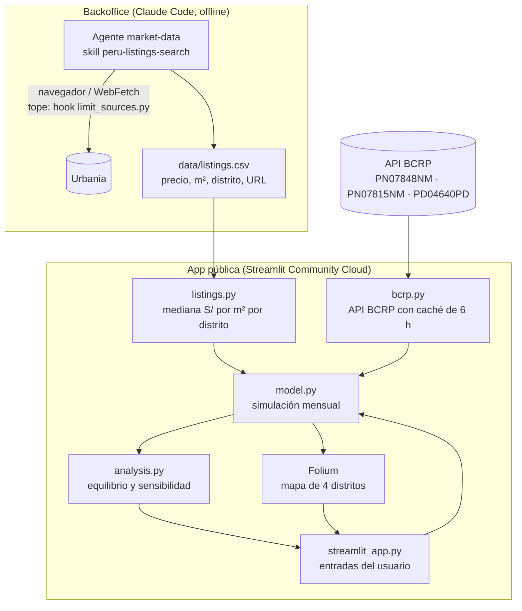

# Arquitectura — Techito Propio

## Flujo de una consulta
1. El usuario elige distrito, m², cuota inicial, horizonte y plazo.
2. `listings.py` calcula precio = mediana S/ por m² de venta × m², y alquiler = mediana S/ por m² de alquiler × m².
3. `bcrp.py` trae la TEA hipotecaria y la tasa de depósitos a plazo (costo de oportunidad).
4. `model.py` simula mes a mes los dos caminos: comprar (cuota, seguros, predial, mantenimiento, alcabala, venta al final) y alquilar e invertir la diferencia.
5. La app muestra la recomendación, el patrimonio, el mapa comparativo, la sensibilidad y los avisos fuente.
